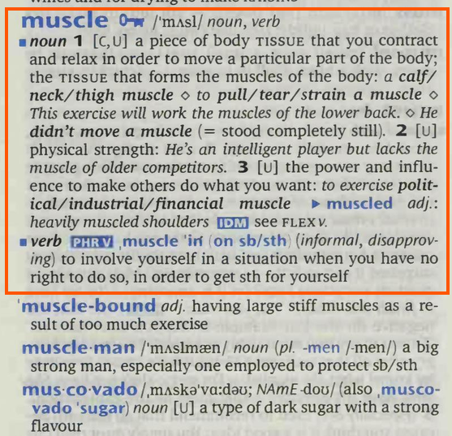

# Text Preprocessing in Natural Language Processing
> **Author: Mason Swanson**

## What is Tokenization
When reading natural language into a computer program, it immediately becomes necessary to identify the boundaries between words. The simple text—"the boy kicked the ball"—can be split into into "the" "boy" "kicked" "the" "ball" by choosing to use space as a delimiter.
```python
alep = "the boy kicked the ball".split(" ")
alep
```
```python
# output
['the', 'boy', 'kicked', 'the', 'ball']
```
This is effective for cases where all of your text is separated by spaces, with no other punctuation, and where capitalization matters. We can see the frequency of each word using some form of counter:
> ```python
> from collections import Counter
> Counter(alep)
> ```
> ```python
> # output
> Counter({'the': 2, 'boy': 1, 'kicked': 1, 'ball': 1})
> ```
Unfortunately, this simple approach does not work in more complicated examples
> ```python
> bet = """Yes or no isn't null; yes it is; no, I don't know
> Yes or no? Isn't it a silly question? Ask it anyway, 'cause""".split(" ")
> bet
> ```
> ```python
> # output
> ['Yes', 'or', 'no', "isn't", 'null;', 'yes', 'it', 'is;', 'no,', 'I', "don't",
>  'know\nYes', 'or', 'no?', "Isn't", 'it', 'a', 'silly', 'question?', 'Ask', 
>  'it', 'anyway,', "'cause"]
> ```


```python
Counter(bet)
```
```python
# output
Counter({'it': 3, 'or': 2, 'Yes': 1, 'no': 1, "isn't": 1, 'null;': 1, 'yes': 1,
         'is;': 1, 'no,': 1, 'I': 1, "don't": 1, 'know\nYes': 1, 'no?': 1,
         "Isn't": 1, 'a': 1, 'silly': 1, 'question?': 1, 'Ask': 1,
         'anyway,': 1, "'cause": 1})
```
The counter is differentiating between `Yes` and `yes`, and it's not separating `know` and `yes` in `know\nYes`. It's also creating different counts for `no`, `no,` and `no?`.

We can force the text to be all uppercase or lowercase, and we could add more separators, but this quickly becomes complicated. 

### Complications With Splitting Text
Typically, an apostrophe character is used in computer text as either a single quote or an apostrophe. Take this example sentence:
> He said 'don't don that t-shirt' to Don---who was doing dishes.
1. If we normalized capitalization, we would be unable to differentiate between don (to put on) and Don (nickname for Donovan).
    - This can sometimes be ignored, but it can be a problem in languages like Turkish where the capital form of i is İ, and the lowercase form of I is ı. Kir means "dirt" but Kır means "countryside".
2. If we added punctuation to the list of separators, we wouldn't have to worry about the single quotes merging into the words `don't` or `t-shirt` or the hypen merging `Don---who`.
    - but we'd end up splitting `don't` into `don` & `t`; and `t-shirt` into `t` & `shirt`.

### Introducing: NLTK Tokenizers
Thankfully, computational linguists have created tools for assisting with these problems. NLTK contains various tokenizers that follow different philosophies. 

As an example, here's how `ToktokTokenizer` performs on last example sentence:
```python
# Natural Language processing tools
import nltk
from nltk.tokenize.toktok import ToktokTokenizer
# Data structure for easy counting
from collections import Counter

giml = "He said 'don't don that t-shirt' to Don---who was doing dishes."

lower_giml = giml.lower()

tokenizer = ToktokTokenizer()
tokenized = tokenizer.tokenize(lower_giml)

tokenized
```
```python
# output
['he', 'said', "'", 'don', "'", 't', 'don', 'that', 't-shirt', "'", 'to',
 'don', '---', 'who', 'was', 'doing', 'dishes', '.']
```
Now with `TreebankWordTokenizer`:
```python
# output
# Natural Language processing tools
import nltk
from nltk.tokenize.treebank import TreebankWordTokenizer
# Data structure for easy counting
from collections import Counter

giml = "He said 'don't don that t-shirt' to Don---who was doing dishes."

lower_giml = giml.lower()

tokenizer = TreebankWordTokenizer()
tokenized = tokenizer.tokenize(lower_giml)

tokenized
```
```python
# output
['he', 'said', "'do", "n't", 'don', 'that', 't-shirt', "'", 'to', 'don', '--',
 '-who', 'was', 'doing', 'dishes', '.']
```

These give different results, but that's okay. 
- Toktok does a better job at splitting up the punctuation, but `don't` splits into `don` & `t`.
- Treebank adds `'` to the first half of `don't`, but it also splits `don't` into `do` and `n't`, which maintains parts of the contraction as separate tokens.
There isn't a known solution to tokenizing the English language right now, so it's important to consider the strengths and weaknesses of your tokenization model.

## What is Stemming?
> *I... do not \*know\* the Sixth Circle as it is \*known\* to others. I fear that the Third Circle, the Fourth Circle and the Sixth Circle are more closely linked than many \*know.\* It is in that \*knowing\* that I have lost myself.*
>
> -- Dak'kon, Planescape Torment

If you only tokenize your texts, you'll be able to do a lot, but trying to run analysis on context or topics will be harder. If you're trying to measure the relevancy of documents to a query (like ranking search results based on a user-input text), you may want to count how many times relevant words from the query appear in each documents. After all, an article which mentions various types of computers should use the word *computers* more than one which only mentions them in passing. But searching for each individual word related to "computer" is expensive. Wouldn't it be nice to search *computer* and have the search engine consider similar words?

That's what stemming is for!

Many related words have similar looks. In English, the words *computes*, *computing*, *computable*, *computed*, *computer*, *computation*, and *computational* are all related to the word *compute*; which finds its origins in the Latin *computō*, meaning calculate. Stemming is a process which reduces words like these into a single **stem**.

Think about how dictionaries work
> 
> 
> *This dictionary has an entry for the word **muscle**, but no separate entries for **muscle<ins>s</ins>**, **muscle<ins>d</ins>**, or **muscl<ins>ing</ins>**.*


Tokenization is great, but is falls

## What is Lemmatization?
Let's take a large step back from the world of programming and think about language. Grab a dictionary, and you'll find that there's usually one entry that unites all of the forms of a word


The group of words that an entry unites is called a **lexeme**, and the word chosen for that entry is called the **lemma**. In the above dictionary entry, *muscle* is the lemma for the lexeme which includes the forms muscles, muscled, muscling.

If you're familiar with the English language, you'll know that not all